# Лабораторная работа № 1. Профилирование Quadtree

## Задача и алгоритм

Взял реализацию Quadtree из второй лабороторной работы прошлого семестра. Работает оно так. Обычно узел хранит до восьми точек. При вставке девятой дерево делит область узла на четыре части. При поиске дерево пропускает узлы за пределами квадрата вокруг запроса. Для точек внутри квадрата оно проверяет, попадают ли они в круг. Расстояние считаю на плоскости координат.

Посмотрел, как работает исходное дерево, и нашёл два места, которые можно попробовать улучшить.

Первое место - вставка. Исходное дерево пробует дочерние квадранты по очереди и каждый раз проверяет границы. Я поменял выбор квадранта. Сравниваю координаты точки с серединами узла и сразу спускаюсь туда, куда она попадает. Рассчитывал, что с меньшим числом проверок дерево будет строиться быстрее.

Второе место - поиск. Исходное дерево сначала собирает список точек внутри квадрата, потом проверяет расстояние и складывает подходящие точки в ещё один список. Я перенёс проверку расстояния в обход дерева и стал сразу добавлять точки в итоговый список. Так на каждый запрос должно выделяться меньше памяти.

В одном классе Quadtree оставил возможность включить каждую правку отдельно или обе сразу. Так можно проверить, сколько даёт каждое изменение и что получается вместе.

В командах JMH названия короткие. BASELINE - исходный способ, CPU - прямой выбор квадранта при вставке, MEMORY - один список при поиске, FULL - обе правки вместе.

На 100 000 точек сравнил построение исходным способом, с прямым выбором квадранта и с обеими правками. Для поиска по готовому дереву сравнил исходный способ, поиск с одним списком и обе правки вместе. Исходный вариант заново замерил для каждого сравнения.

Во всех режимах поиск должен находить одни и те же точки. Проверил вставку, точки на границах, одинаковые координаты и совпадение результатов с полным перебором. Все 20 тестов прошли.

## Условия измерений

MacBook Air с Apple M4 (10 ядер) и 24 ГБ оперативной памяти. OpenJDK 25.0.2, JMH 1.37.

Настройки JMH - один поток, два запуска JVM на вариант, по три итерации прогрева и пять итераций замера. Каждая итерация длилась 500 мс. Для JFR - один запуск JVM и 2 с на измерительную итерацию.

Проверил наборы из 10 000, 100 000 и 300 000 точек. Для поиска задал радиус 10 и 500 центров, которые бенчмарк перебирает по кругу. Точки и центры готовятся заранее с фиксированными seed, поэтому у сравниваемых вариантов одинаковые данные. Дерево для поиска тоже строится до замера. Бенчмарк построения возвращает готовое дерево, а бенчмарк поиска - список найденных точек. Рядом со средними значениями указана погрешность JMH для доверительного интервала 99,9%.

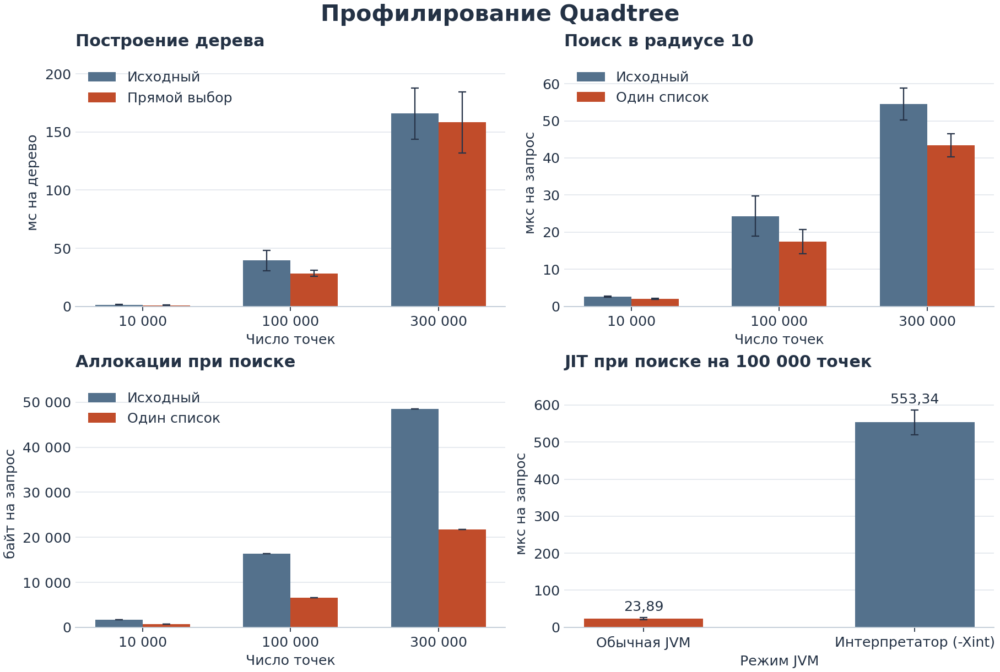

## CPU при построении дерева

При вставке исходное дерево пробовало квадранты по очереди. Каждая попытка проверяла, входит ли точка в границы квадранта. При прямом выборе хватает двух сравнений с серединой узла. По широте выбираю север или юг, по долготе - запад или восток. Для точек ровно на линии деления оставил тот же выбор, что и в исходном дереве.

| Число точек | Исходный, мс на дерево | Прямой выбор, мс на дерево | Изменение среднего времени |
| ---: | ---: | ---: | ---: |
| 10 000 | 1,432 ± 0,136 | 0,941 ± 0,115 | −34,3% |
| 100 000 | 39,440 ± 8,831 | 28,447 ± 2,760 | −27,9% |
| 300 000 | 165,862 ± 22,000 | 158,195 ± 26,313 | −4,6% |

На 10 000 точек прямой выбор сократил время построения, и интервалы не пересеклись. На 100 000 и 300 000 среднее время тоже снизилось, но интервалы перекрылись.

Посмотрел JFR-профили на 100 000 точек. В исходном варианте JFR чаще всего заставал программу в insideBox, который проверяет границы. На этот метод пришлось 53,77% CPU-выборок. При прямом выборе квадранта его доля упала до 0,42%, а чаще всего в профиле встречался insertIntoChildren (69,89%).

В профилях аллокаций при построении больше всего памяти выделялось при делении узлов, создании их списков и росте этих списков. Прямой выбор квадранта убрал часть проверок, а для хранения дерева по-прежнему создаются те же узлы и списки.

## Аллокации при поиске

В исходном поиске получалось два списка. В первый попадали точки внутри квадрата, во второй - точки из первого списка, прошедшие проверку расстояния. Чтобы обойтись одним списком, перенёс эту проверку прямо в обход дерева. Если точка попадает в круг, она сразу идёт в итоговый список.

| Число точек | Исходный, мкс на запрос | Один список, мкс на запрос | Исходный, байт на запрос | Один список, байт на запрос |
| ---: | ---: | ---: | ---: | ---: |
| 10 000 | 2,656 ± 0,121 | 2,003 ± 0,142 | 1 651,59 ± 0,04 | 731,69 ± 0,01 |
| 100 000 | 24,332 ± 5,359 | 17,492 ± 3,233 | 16 338,42 ± 1,16 | 6 615,46 ± 0,29 |
| 300 000 | 54,525 ± 4,344 | 43,421 ± 3,114 | 48 547,62 ± 5,70 | 21 770,12 ± 2,53 |

В GC-профиле смотрел на gc.alloc.rate.norm. Это среднее число байтов, выделенных на один запрос. На всех трёх размерах их стало меньше на 55–60%. На 100 000 точек за измерительные итерации было 8 сборок мусора вместо 13, а суммарное время GC вышло близким - 71 мс у исходного варианта и 68 мс при одном списке. Время поиска взял из запуска без профилировщика. Среднее снизилось на всех размерах, а интервалы не пересеклись на 10 000 и 300 000 точек.

В CPU-профиле исходного поиска больше всего выборок пришлось на обход Node.search (50,98%). При одном списке больше всего выборок пришлось на обход Node.searchInRadius (60,89%). В профиле аллокаций исходного поиска видно, как растут оба списка. После правки остаётся рост итогового списка. В обоих случаях массив при росте копирует Arrays.copyOf. Профиль JFR показывает, где память выделяется, а байты на запрос беру из gc.alloc.rate.norm.

## Обе оптимизации вместе

Проверил обе правки вместе на 100 000 точек и радиусе 10. Замеры запустил с GC-профилировщиком, чтобы в одном прогоне сравнить время и объём выделенной памяти.

Сделал два прогона. Во втором поменял порядок вариантов на обратный.

| Операция | Вариант | Первый прогон | Повтор |
| --- | --- | ---: | ---: |
| Построение, мс | Исходный | 38,409 ± 4,651 | 36,556 ± 3,308 |
| Построение, мс | Прямой выбор | 29,867 ± 3,904 | 29,317 ± 3,712 |
| Построение, мс | Обе правки | 29,516 ± 4,429 | 33,842 ± 9,293 |
| Поиск, мкс | Исходный | 24,790 ± 7,276 | 21,752 ± 1,647 |
| Поиск, мкс | Один список | 17,286 ± 2,388 | 16,938 ± 1,328 |
| Поиск, мкс | Обе правки | 17,099 ± 1,215 | 17,500 ± 3,012 |

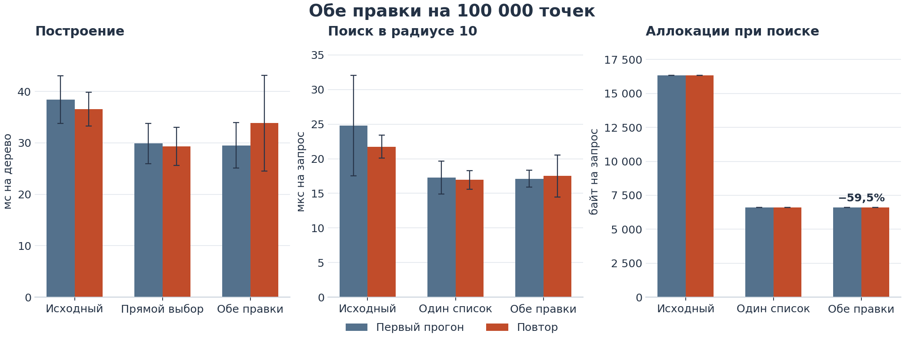

По памяти результат повторился. С обеими правками выделялось около 6 615 байт на запрос против примерно 16 339 в исходном варианте. Это на 59,5% меньше и примерно столько же, сколько при поиске с одним списком. При построении во всех трёх вариантах выделялось около 5,30 МБ на дерево.

Прямой выбор квадранта сократил среднее время построения примерно на 20–22% в двух прогонах с GC-профилировщиком. Интервалы с исходным вариантом не пересеклись в повторе. С обеими правками среднее время построения и поиска тоже было ниже исходного, но интервалы перекрылись в обоих прогонах. По времени вариант с обеими правками сложно отличить от соответствующего варианта с одной правкой.

В CPU-профиле построения с обеими правками на insideBox пришлось 0,41% выборок, а на insertIntoChildren - 69,08%. При поиске чаще всего встречался Node.searchInRadius (56,83%), как и в варианте с одним списком. В профиле аллокаций виден рост итогового списка.

## Влияние JIT и прогрева

Взял исходный поиск на 100 000 точек и запустил его два раза с одинаковыми настройками JMH Blackhole. Первый раз запустил обычную JVM, второй - с флагом -Xint, который отключает JIT-компиляцию. Получилось 23,887 ± 3,055 мкс на запрос с JIT и 553,338 ± 33,336 мкс с -Xint. Разница - примерно в 23,2 раза.

Ещё посмотрел, что происходило на прогреве. В первом процессе JVM время запроса снизилось с 29,769 мкс на первой итерации до 25,693 мкс на третьей. Во втором - с 29,280 до 23,952 мкс. В журнале -XX:+PrintCompilation видно, что JVM скомпилировала Quadtree.searchInRadius и Quadtree.Node.search до уровня 4 HotSpot.

## Результаты прошлой лабораторной

В прошлой лабораторной я сравнивал дерево с полным перебором. На 100 000 точек построение Quadtree заняло 11,963 мс, а подготовка наивного индекса - 0,384 мс. При радиусе 10 поиск по дереву занял 11,336 мкс, а перебор - 122,212 мкс. То есть в том замере на построение дерева уходило больше времени, а поиск был примерно в 10,8 раза быстрее. Цифры взял из lab-2-geo/benchmarks/all.json.

Тогда поиск шёл пачками по 500 запросов. Бенчмарк возвращал число найденных точек, а при построении - размер дерева. JMH запускался с -f 0, то есть без отдельных процессов JVM. Проценты улучшения посчитал по замерам этой работы, где сравниваемые варианты запускались в одинаковых условиях для каждой операции.

## Вывод

У Quadtree есть понятный компромисс. Чтобы быстрее искать точки, сначала нужно потратить время на построение индекса. Для набора, который редко меняется, это разовый расход, а память при поиске выделяется на каждый запрос. Самый устойчивый результат получился по памяти. С одним списком на запрос выделяется примерно на 55–60% меньше байтов. Эффект прямого выбора квадранта по времени зависел от размера набора.

## Как повторить замеры

Запускал команды из корня репозитория с JDK 25.

```bash
./gradlew :lab-1-profiling:test
out=lab-1-profiling/build/measurements/repeat
mkdir -p "$out"

./gradlew :lab-1-profiling:jmh \
  --args="GeoIndexBenchmark -p radius=10.0 -rf csv -rff $out/timing.csv"

./gradlew :lab-1-profiling:jmh \
  --args="GeoIndexBenchmark.searchInRadius -p radius=10.0 -prof gc -rf csv -rff $out/gc.csv"

./gradlew :lab-1-profiling:jmh \
  --args="GeoIndexBenchmark.buildQuadtree -p size=100000 -p variant=BASELINE,CPU,FULL -f 1 -r 2s -prof jfr:dir=$out/jfr/build;configName=profile"

./gradlew :lab-1-profiling:jmh \
  --args="GeoIndexBenchmark.searchInRadius -p size=100000 -p radius=10.0 -p variant=BASELINE,MEMORY,FULL -f 1 -r 2s -prof jfr:dir=$out/jfr/search;configName=profile"

./gradlew :lab-1-profiling:jmh \
  --args="GeoIndexBenchmark.buildQuadtree -p size=100000 -p variant=BASELINE,CPU,FULL -prof gc -rf csv -rff $out/full-build.csv"

./gradlew :lab-1-profiling:jmh \
  --args="GeoIndexBenchmark.searchInRadius -p size=100000 -p radius=10.0 -p variant=BASELINE,MEMORY,FULL -prof gc -rf csv -rff $out/full-search.csv"

bench='GeoIndexBenchmark.searchInRadius -p size=100000 -p radius=10.0 -p variant=BASELINE'
JDK_JAVA_OPTIONS=-Djmh.blackhole.autoDetect=false ./gradlew :lab-1-profiling:jmh \
  --args="$bench -rf csv -rff $out/jit.csv"
JDK_JAVA_OPTIONS=-Djmh.blackhole.autoDetect=false ./gradlew :lab-1-profiling:jmh \
  --args="$bench -jvmArgsAppend=-Xint -rf csv -rff $out/xint.csv"
JDK_JAVA_OPTIONS=-Djmh.blackhole.autoDetect=false ./gradlew :lab-1-profiling:jmh \
  --args="$bench -f 1 -jvmArgsAppend=-XX:+PrintCompilation" > "$out/compilation.log" 2>&1
```

Для повтора замеров с обеими правками использовал те же команды. Порядок режимов поменял на FULL,CPU,BASELINE для построения и FULL,MEMORY,BASELINE для поиска. Результаты сохранил в отдельные CSV.

## Профили

### CPU при построении

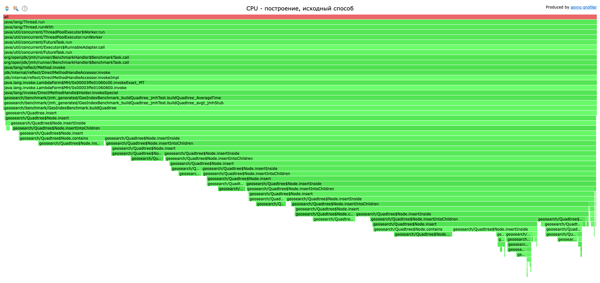

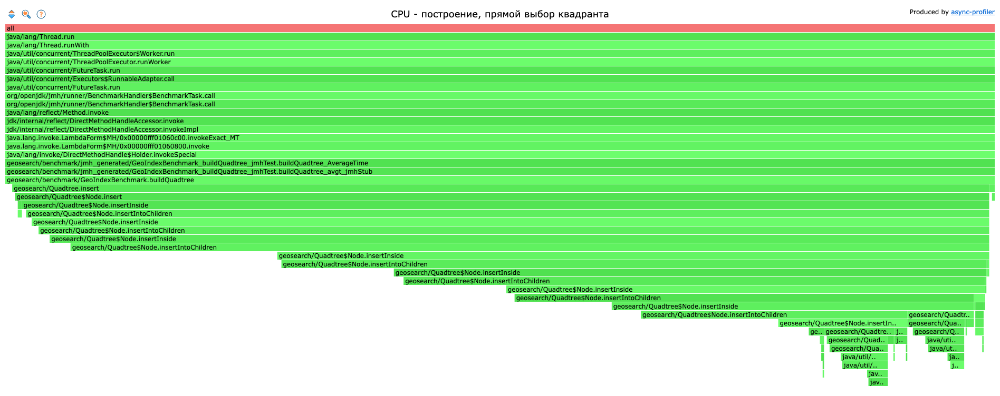

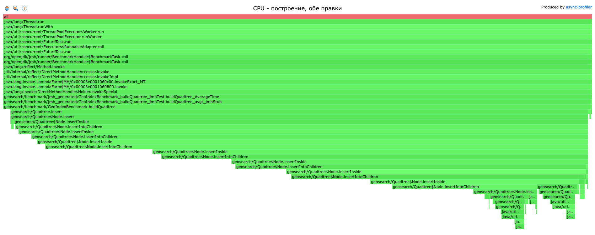

### Аллокации при построении

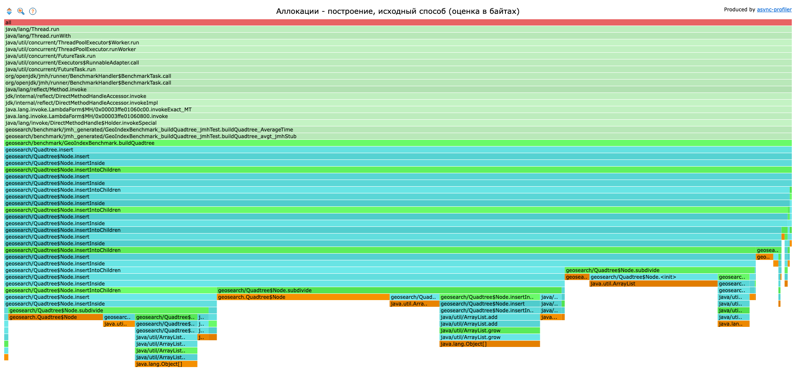

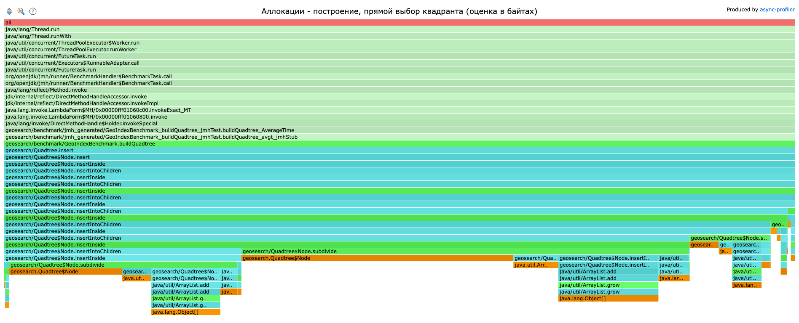

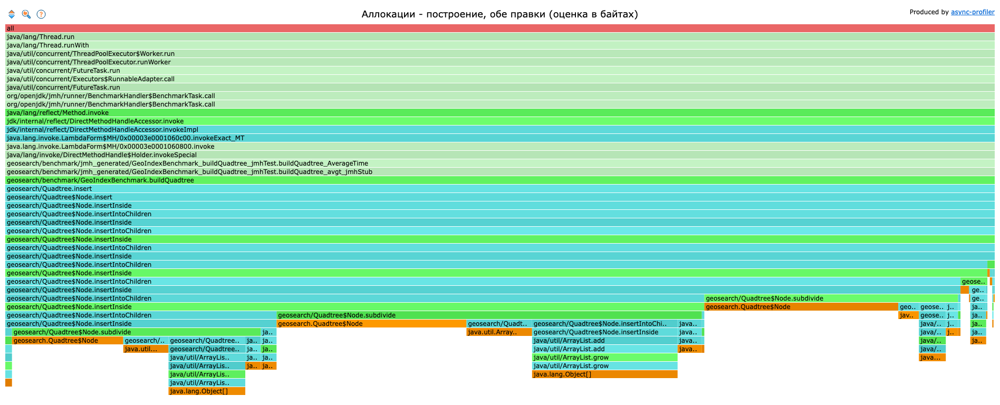

### CPU при поиске

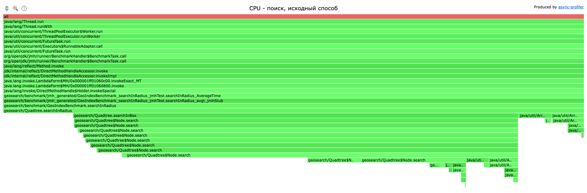

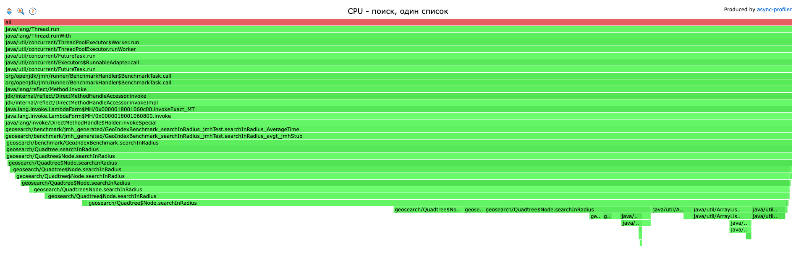

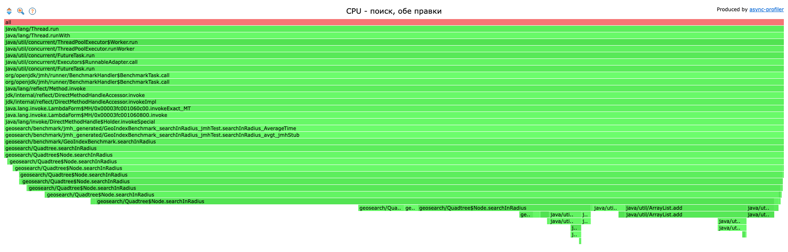

### Аллокации при поиске

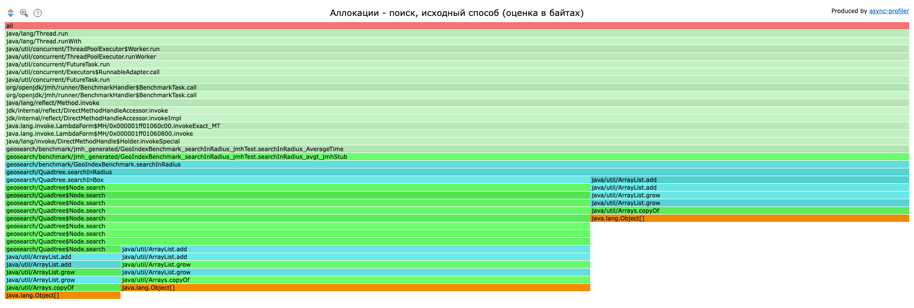

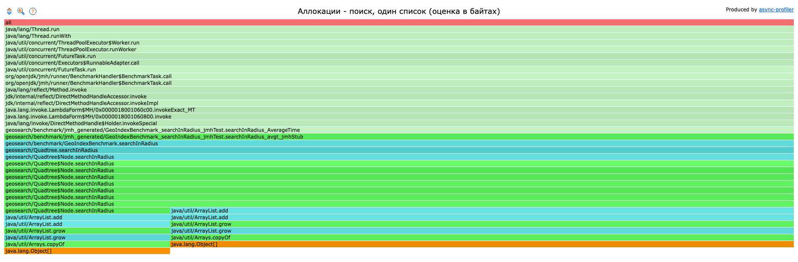

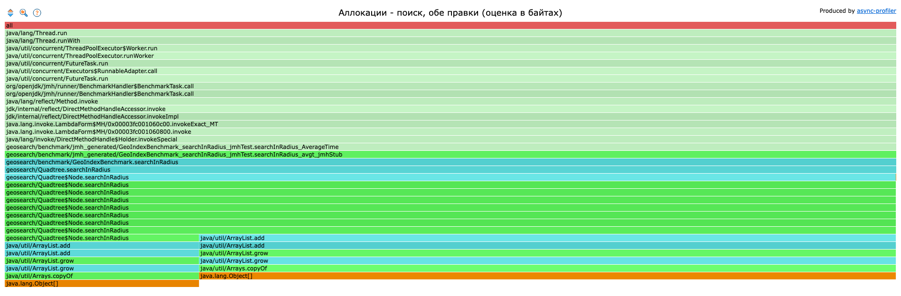
